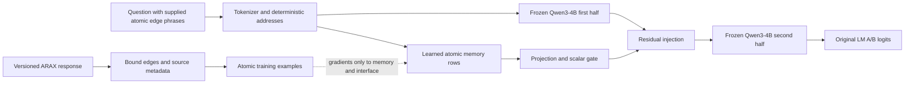
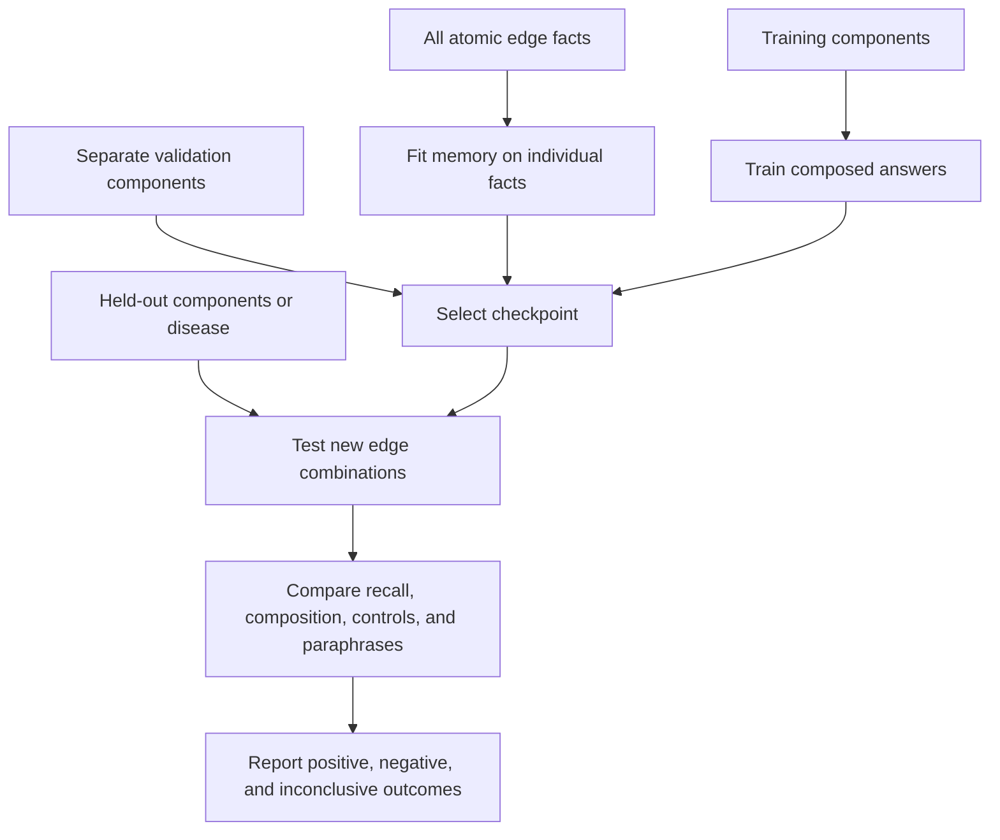

# MLX Biomedical Memory

An experimental, local Apple-silicon test of whether a frozen backbone with trained readers can
compose independently stored graph facts into answers that were never training
targets. The biomedical case studies use live NCATS Translator ARAX queries for
Fabry disease, Gaucher disease, and Rett syndrome.

**Research prototype. No improvement over LLM + KG is assumed. A retrieved path
is not a treatment recommendation, and a composed graph answer is not a new
biological discovery.** See [measured results](docs/RESULTS.md).

The latest **[trained-memory versus text comparison](docs/DECISIVE-RESULTS.md)**
uses a query-independent seven-field codec, LoRA readers, two training seeds and
fresh worlds with held-out longer paths. It reports actual generated proofs,
atomic readout, evidence changes, record bindings, masking and fair text-prefix
reuse. [Reproduce it](docs/DECISIVE-REPRODUCTION.md), or inspect the
[architecture and registered protocol](docs/DECISIVE-PROTOCOL.md). The learned
codec is an engineered interface, not an EngramEdit replication.

**Measured result:** the trained-memory diagnostic gets 0/192 exact record
readouts and 0/72 valid two-hop proofs, versus 192/192 and 32/72 for trained text.
This recipe failed the memory-access prerequisite; it does not establish that
reliably trained conditional memory cannot support reasoning.

Read-only disk-backed lookup preserves the native n-gram tables while keeping
this experiment's model allocations below its 27 GB Metal limit. Large model
runs are serialized and aggregate host pressure/swap are monitored.

The earlier experiment uses **native pretrained LongCat-Flash-Lite conditional
memory**, with a quantization-aware MLX adaptation for fitting new atomic edits.
See the **[controlled KG/RAG/memory comparison](docs/COMPARISON.md)** for answer
quality, fixed-length latency, corrections, rollback and scaling limits.
The **[richer relationship protocol](docs/RELATIONAL-PROTOCOL.md)** adds explicit
relation/context addresses, branching joins, context selection, signed paths,
source deduplication, conflict and missing-edge hypotheses. It separates
gold-evidence controls from agents that choose their own graph lookups.
Its **[measured results and comparison tables](docs/RELATIONAL-RESULTS.md)** retain
all primary outcomes, development attempts and post-hoc diagnostics. The scoped
bank is an engineered addition to the native model, rather than native addressing.
See [the practical rationale and decision criteria](docs/RATIONALE.md) for what
would justify this approach beyond an ordinary graph, RAG or a rule library.
The follow-up **[registered memory-use experiment](docs/DECISIVE-PROTOCOL.md)**
trains an atomic codec and reader on actual executions, with a larger text
adapter, fresh-world and structural tests, and a bounded resource policy.
The earlier [released-checkpoint replay](docs/LONGCAT-RESULTS.md) is retained
separately. This is a 4-bit adaptation of EngramEdit, with fixed expression
templates and local frequency calibration; it is not an exact paper replication.

## What is implemented

- Matched reader training with frozen causal-prefix features, exact atomic
  reconstruction targets, executable path grading, two fitted seeds and public
  BF16 candidate checkpoints. Training success and development gate failures
  are reported explicitly; implementing an interface does not establish utility.
- Native LongCat-Flash-Lite 4-bit on MLX, pinned model and edited-state revisions,
  cached exact-key residual replay, and base / edited-memory / text-edit controls.
- Fresh atomic target-vector fitting with a frozen backbone, joint regularized
  n-gram allocation, sequential corrections and independent snapshot rollback.
- An engineered scoped residual bank, atomic address-interference diagnostics,
  generic rule fitting, new synthetic worlds and qualifier-preserving ARAX audits.
  Answer labels and retrieved proof support are checked separately.
- Same-corpus graph traversal, SQLite FTS5 BM25, pinned BGE dense and hybrid RAG,
  gold-support, cached-prefix and shuffled-memory controls. Atomic recall,
  paraphrases, unseen compositions, absent entities and unrelated queries.
- Generated MQuAKE answers with standard and CoT prompts, upstream answer matching,
  source snapshots and checksums, PyTorch residual parity, and tokenizer parity.
- Qwen3-4B BF16 on MLX, with its exact Hugging Face revision pinned.
- A separately trained, deterministic phrase-addressed latent memory, projected
  into the middle of the frozen decoder through a learned scalar gate.
- Synthetic sign composition and an ARAX-derived snapshot-membership benchmark.
- Atomic-fact supervision for all splits; composed-answer supervision only for
  training components. Checkpoint selection uses validation, never test accuracy.
- Frozen-model, supplied-text-fact, latent-memory, and shuffled-memory controls.
- Held-out question paraphrases, per-example scores, raw logs, complete backbone
  parameter digests, dataset hashes, source-code hashes, and memory checkpoints.
- ARAX identity resolution, raw HTTP receipts, bound-edge normalization, original
  directions/predicates/qualifiers, primary versus aggregator sources, and warnings.

The original Qwen interface is **Engram-inspired engineering**, not a reproduction
of DeepSeek Engram or EngramEdit. Its keys are explicit canonical atomic edge phrases, with
open-addressed hash slots. The lookup code does not traverse a graph, combine
edge labels, or compute the answer. The supplied path identifies which independent
atomic memories to activate. Generic token-suffix lookup and hidden-path search
are not implemented.

## Original Qwen architecture



## Run on an Apple-silicon Mac

Tested on an M5 Max MacBook Pro with 64 GB unified memory. Python 3.13 is used in
an isolated environment. Original upstream base weights are cached locally;
adapters and codecs are published with source, input and checkpoint receipts.
For the latest learned-reader study, use the
[reproduction instructions](docs/DECISIVE-REPRODUCTION.md). The commands below
retain the earlier experiments and their original loading profiles.

```bash
# Earlier native-memory experiment: about 38.6 GB of base weights.
uv sync --extra dev --extra longcat
uv run --extra longcat python scripts/prepare_longcat.py --download-model
uv run python scripts/run_longcat.py --cases 30 --questions-per-case 3 \
  --output runs/longcat-mquake-30

# Fresh fitting and the matched comparison, using the exact public corpus.
# Omit --replay only to rebuild from retained local snapshots.
uv run --extra longcat python scripts/prepare_comparison.py --replay
uv run --extra longcat python scripts/run_comparison.py
uv run --extra longcat python scripts/benchmark_comparison_latency.py
uv run --extra longcat python scripts/diagnose_comparison_memory.py
uv run --extra longcat python scripts/audit_abstention.py
OPENBLAS_NUM_THREADS=1 uv run python scripts/benchmark_lookup_scaling.py
uv run python scripts/report_comparison.py

# Richer relations, using the released frozen corpus and a new scoped checkpoint.
uv run --extra longcat python scripts/prepare_relational.py --replay --cache-encoder
uv run --extra longcat python scripts/fit_relational_memory.py
uv run --extra longcat python scripts/run_relational.py --dev-only --output runs/relational-dev-v3
uv run --extra longcat python scripts/run_relational.py
uv run --extra longcat python scripts/diagnose_scoped_transfer.py
uv run --extra longcat python scripts/diagnose_value_boundary.py
uv run python scripts/audit_relational_arax.py --replay
uv run python scripts/report_relational.py
uv run python scripts/verify_artifacts.py

# Original Qwen graph-composition experiment, retained for reproduction.
uv sync --extra dev
uv run pytest -q

# Reproduce a controlled synthetic experiment. The first download is about 8 GB.
uv run engram-poc experiment --seed 23 --steps 480 --dimension 1 \
  --eval-every 120 --output runs/synthetic-seed23

# Fetch current ARAX neighborhoods, saving exact local response bytes and hashes.
uv run engram-poc arax --output data/processed/arax \
  --max-results 30 --timeout 90

# Actual biomedical graph facts, with anonymous entity identifiers.
uv run engram-poc experiment --arax-snapshot data/processed/arax \
  --seed 17 --steps 480 --dimension 1 --eval-every 120 \
  --output runs/arax-seed17

# Local evidence browser; it does not generate therapeutic conclusions.
uv run python scripts/arax_report.py --snapshot data/processed/arax \
  --output runs/arax-evidence.html
```

The original Qwen experiment supports only `Qwen/Qwen3-4B-MLX-bf16` at revision
`94e68620a4b9db944b2f5b3c3633fbdf621d871b` is currently supported by the experiment
runner. Trainable memory dimensions 1 and 64 are exploratory settings, not
established optimal designs. Default optimizer settings are deliberately exposed.
Memory now starts at zero; use `--memory-initialization random` to reproduce the
earlier random-row initialization, with the corresponding source revision. The
three fresh zero-initialization seeds are 101, 202, and 303.

A released prepared benchmark can also be replayed with
`--dataset artifacts/<run>/dataset.json`. The loader verifies its checksum.
This permits exact replay of the blinded ARAX task without redistributing the raw
composite source graph or relying on a future live response being identical.

## Original Qwen training protocol



Synthetic tests measure stipulated sign multiplication on supplied paths.
ARAX tests measure whether both supplied directed edges are **recorded in a
bounded snapshot**. They do not infer that a chemical treats a disease. Negative
controls use real identifiers and keep the shared gene, so disconnected text
cannot trivially reveal the label. Entity identifiers are blinded before fitting.

ARAX experiments hold out Rett syndrome's composed questions, validate on
Gaucher disease, and train composed questions on Fabry disease. Individual
premises from all three diseases are intentionally available to memory. This tests
composition of stored facts, not generalization to facts never supplied.

In the original Qwen experiment, the text-fact control supplies the relevant facts directly and is a strong,
oracle-retrieval LLM+KG comparator. All conditions use the same frozen model and
closed-set A/B scoring. This is not yet a comparison of unrestricted generated
scientific explanations. [Protocol and limitations](docs/PROTOCOL.md).

The LongCat replay generates counterfactual MQuAKE answers using published edits
and standard/CoT demonstrations. The fresh comparison starts from the native
base, fits individual premises, and evaluates composed outputs never used as
targets. Its ARAX task is an anonymized selected-neighbor view, not a biomedical
causality or therapeutic-discovery benchmark. See the [comparison](docs/COMPARISON.md).

## Data and reproducibility

Synthetic datasets, scores, configurations, and training logs are published under
`artifacts/`. Model weights and raw composite upstream biomedical data stay local.
The ARAX snapshot's receipts and hashes document what was queried; fetching again
may return a different graph. Exact public reproduction of an ARAX result requires
the same snapshot, subject to its upstream data terms. ARAX's software license is
not blanket permission for every upstream data source.

The code license is MIT. Model and dataset licenses remain separate. References:
[DeepSeek Engram](https://github.com/deepseek-ai/Engram),
[TinyEngram](https://github.com/AutoArk/TinyEngram),
[MLX-LM](https://github.com/ml-explore/mlx-lm),
[Qwen3-4B MLX](https://huggingface.co/Qwen/Qwen3-4B-MLX-bf16), and
[ARAX](https://github.com/RTXteam/RTX).
