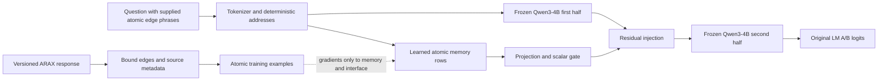
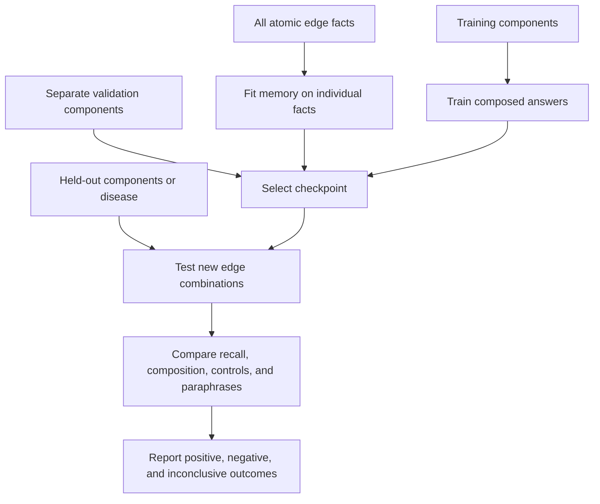

# MLX Biomedical Memory

An experimental, local Apple-silicon test of whether a frozen language model can
compose independently stored graph facts into answers that were never training
targets. The biomedical case studies use live NCATS Translator ARAX queries for
Fabry disease, Gaucher disease, and Rett syndrome.

**Research prototype. No improvement over LLM + KG is assumed. A retrieved path
is not a treatment recommendation, and a composed graph answer is not a new
biological discovery.** See [measured results](docs/RESULTS.md).

## What is implemented

- Qwen3-4B BF16 on MLX, with its exact Hugging Face revision pinned.
- A separately trained, deterministic phrase-addressed latent memory, projected
  into the middle of the frozen decoder through a learned scalar gate.
- Synthetic sign composition and an ARAX-derived snapshot-membership benchmark.
- Atomic-fact supervision for all splits; composed-answer supervision only for
  training components. Checkpoint selection uses validation, never test accuracy.
- Frozen-model, supplied-text-fact, latent-memory, and shuffled-memory controls.
- Held-out question paraphrases, per-example scores, raw logs, complete backbone
  parameter digests, dataset hashes, source-code hashes, and memory checkpoints.
- ARAX identity resolution, raw HTTP receipts, bound-edge normalization, original
  directions/predicates/qualifiers, primary versus aggregator sources, and warnings.

This is **Engram-inspired engineering**, not a reproduction of DeepSeek Engram or
an MLX port of EngramEdit. Keys are explicit canonical atomic edge phrases, with
open-addressed hash slots. The lookup code does not traverse a graph, combine
edge labels, or compute the answer. The supplied path identifies which independent
atomic memories to activate. Generic token-suffix lookup and hidden-path search
are not implemented.

## Architecture



## Run on an Apple-silicon Mac

Tested on an M5 Max MacBook Pro with 64 GB unified memory. Python 3.13 is used in
an isolated environment. Models are cached locally and are not checked into Git.

```bash
uv sync --extra dev
uv run pytest -q

# Reproduce a controlled synthetic experiment. The first download is about 8 GB.
uv run engram-poc experiment --seed 23 --steps 480 --dimension 1 \
  --eval-every 120 --output runs/synthetic-seed23

# Fetch current ARAX neighborhoods, saving exact local response bytes and hashes.
uv run engram-poc arax --output data/processed/arax \
  --max-results 30 --timeout 90

# Actual biomedical graph facts, with anonymous entity identifiers.
uv run engram-poc experiment --arax-snapshot data/processed/arax \
  --seed 17 --steps 480 --dimension 1 --eval-every 120 \
  --output runs/arax-seed17

# Local evidence browser; it does not generate therapeutic conclusions.
uv run python scripts/arax_report.py --snapshot data/processed/arax \
  --output runs/arax-evidence.html
```

Only `Qwen/Qwen3-4B-MLX-bf16` at revision
`94e68620a4b9db944b2f5b3c3633fbdf621d871b` is currently supported by the experiment
runner. Trainable memory dimensions 1 and 64 are exploratory settings, not
established optimal designs. Default optimizer settings are deliberately exposed.
Memory now starts at zero; use `--memory-initialization random` to reproduce the
earlier random-row initialization, with the corresponding source revision. The
three fresh zero-initialization seeds are 101, 202, and 303.

A released prepared benchmark can also be replayed with
`--dataset artifacts/<run>/dataset.json`. The loader verifies its checksum.
This permits exact replay of the blinded ARAX task without redistributing the raw
composite source graph or relying on a future live response being identical.

## What counts as evidence



Synthetic tests measure stipulated sign multiplication on supplied paths.
ARAX tests measure whether both supplied directed edges are **recorded in a
bounded snapshot**. They do not infer that a chemical treats a disease. Negative
controls use real identifiers and keep the shared gene, so disconnected text
cannot trivially reveal the label. Entity identifiers are blinded before fitting.

ARAX experiments hold out Rett syndrome's composed questions, validate on
Gaucher disease, and train composed questions on Fabry disease. Individual
premises from all three diseases are intentionally available to memory. This tests
composition of stored facts, not generalization to facts never supplied.

The text-fact control supplies the relevant facts directly and is a strong,
oracle-retrieval LLM+KG comparator. All conditions use the same frozen model and
closed-set A/B scoring. This is not yet a comparison of unrestricted generated
scientific explanations. [Protocol and limitations](docs/PROTOCOL.md).

## Data and reproducibility

Synthetic datasets, scores, configurations, and training logs are published under
`artifacts/`. Model weights and raw composite upstream biomedical data stay local.
The ARAX snapshot's receipts and hashes document what was queried; fetching again
may return a different graph. Exact public reproduction of an ARAX result requires
the same snapshot, subject to its upstream data terms. ARAX's software license is
not blanket permission for every upstream data source.

The code license is MIT. Model and dataset licenses remain separate. References:
[DeepSeek Engram](https://github.com/deepseek-ai/Engram),
[TinyEngram](https://github.com/AutoArk/TinyEngram),
[MLX-LM](https://github.com/ml-explore/mlx-lm),
[Qwen3-4B MLX](https://huggingface.co/Qwen/Qwen3-4B-MLX-bf16), and
[ARAX](https://github.com/RTXteam/RTX).
