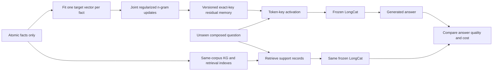

# LongCat on a 64 GB Mac: controlled comparison

This experiment tests whether freshly fitted conditional memory supports unseen compositions of stored facts. It does not test a new disease mechanism or treatment. All completed outcomes and raw generations are published.

**Measured result:** fresh memory recalls 59.3% (16/27) atomic facts, versus 11.1% (3/27) for the native model and 3.7% (1/27) after shuffling residuals. On unseen composed questions with CoT it reaches 2.8% (1/36), versus 94.4% (34/36) for KG + LongCat. This implementation shows a content-dependent recall effect, but does not earn an advantage over KG/RAG for reasoning. It is not evidence against every conditional-memory architecture or the paper's original BF16 setup.

Frozen 4-bit LongCat-Flash-Lite; 27 atomic facts; six MQuAKE cases (two each at 2, 3 and 4 hops); three ARAX disease views; 97 unique questions; 120 retrieval distractors. Only individual atomic answers were fitting targets. Three composed variants per case/path are correlated observations.



## Answer quality

| Condition | Recall (27) | Paraphrases (20) | Composition direct (36) | Composition CoT (36) | ARAX view CoT (18) | Absent entity (6) | Locality (8) |
|---|---|---|---|---|---|---|---|
| Native LongCat | 11.1% (3/27) | 0.0% (0/20) | 5.6% (2/36) | 0.0% (0/36) | 0.0% (0/18) | 100.0% (6/6) | 100.0% (8/8) |
| Shuffled memory | 3.7% (1/27) | 0.0% (0/20) | 0.0% (0/36) | 0.0% (0/36) | 0.0% (0/18) | 100.0% (6/6) | 100.0% (8/8) |
| Fresh memory | 59.3% (16/27) | 35.0% (7/20) | 2.8% (1/36) | 2.8% (1/36) | 0.0% (0/18) | 100.0% (6/6) | 100.0% (8/8) |
| Fresh memory + prefix cache | 59.3% (16/27) | 35.0% (7/20) | 2.8% (1/36) | 5.6% (2/36) | 0.0% (0/18) | 100.0% (6/6) | — |
| BM25 RAG | 100.0% (27/27) | 100.0% (20/20) | 47.2% (17/36) | 36.1% (13/36) | 61.1% (11/18) | 100.0% (6/6) | — |
| BGE dense RAG | 100.0% (27/27) | 100.0% (20/20) | 19.4% (7/36) | 22.2% (8/36) | 0.0% (0/18) | 66.7% (4/6) | — |
| Hybrid RAG | 100.0% (27/27) | 100.0% (20/20) | 19.4% (7/36) | 22.2% (8/36) | 22.2% (4/18) | 50.0% (3/6) | — |
| KG + LongCat | 88.9% (24/27) | 100.0% (20/20) | 91.7% (33/36) | 94.4% (34/36) | 94.4% (17/18) | 100.0% (6/6) | — |
| KG + LongCat + prefix cache | 88.9% (24/27) | 100.0% (20/20) | 91.7% (33/36) | 94.4% (34/36) | 94.4% (17/18) | 100.0% (6/6) | — |
| Gold facts + LongCat | 88.9% (24/27) | 100.0% (20/20) | 91.7% (33/36) | 94.4% (34/36) | 94.4% (17/18) | 100.0% (6/6) | — |
| KG only (supplied query plan) | 100.0% (27/27) | 100.0% (20/20) | 100.0% (36/36) | 100.0% (36/36) | 100.0% (18/18) | 100.0% (6/6) | — |

Percentages use strict normalized answer-label matching, with retained aliases. CoT permits intermediate text and requires a final `Answer:` label. KG-only is symbolic traversal with a supplied entity and hop count; its values in the composition columns are the same structured answers, not CoT generations. The supplied query plan also assists KG + LongCat. Gold facts are an oracle support control. RAG uses actual SQLite FTS5 BM25, pinned BGE-small-en-v1.5 cosine retrieval, or reciprocal-rank fusion, top four records. These are bounded baselines, not a survey of the best agentic or multi-stage RAG systems.

### Secondary format sensitivity

| Condition | Primary CoT (line-start Answer) | Secondary CoT (inline Answer allowed) | Missing primary answer marker | Hit 128-token limit |
|---|---|---|---|---|
| Native LongCat | 0.0% (0/36) | 0.0% (0/36) | 9 | 13 |
| Shuffled memory | 0.0% (0/36) | 0.0% (0/36) | 18 | 15 |
| Fresh memory | 2.8% (1/36) | 2.8% (1/36) | 16 | 16 |
| Fresh memory + prefix cache | 5.6% (2/36) | 5.6% (2/36) | 15 | 14 |
| BM25 RAG | 36.1% (13/36) | 52.8% (19/36) | 12 | 7 |
| BGE dense RAG | 22.2% (8/36) | 27.8% (10/36) | 13 | 9 |
| Hybrid RAG | 22.2% (8/36) | 27.8% (10/36) | 14 | 9 |
| KG + LongCat | 94.4% (34/36) | 100.0% (36/36) | 2 | 1 |
| KG + LongCat + prefix cache | 94.4% (34/36) | 100.0% (36/36) | 2 | 1 |
| Gold facts + LongCat | 94.4% (34/36) | 100.0% (36/36) | 2 | 1 |

This secondary parser was added after inspecting early outputs that contained a correct inline `Answer:` marker. It takes the last explicit answer marker on any line and keeps the same exact-label/alias matcher. Primary scores are unchanged; all methods use the identical secondary rule. This measures sensitivity to answer formatting, not a retuned model. Correct final labels do not independently validate every intermediate reasoning statement.

## Fixed-length latency

| Condition | Prefix state | Requests | Total prompt tokens, median | Tokens evaluated, median | Wall p50, s | Wall p95, s | Retrieval p50, ms |
|---|---|---|---|---|---|---|---|
| Fresh memory | No prefix reuse | 24 | 87 | 87 | 0.468 | 0.559 | 0.00 |
| Fresh memory | Warm prefix | 24 | 87 | 30 | 0.416 | 0.511 | 0.00 |
| KG + LongCat | No prefix reuse | 24 | 132 | 132 | 0.412 | 0.539 | 0.01 |
| KG + LongCat | Warm prefix | 24 | 132 | 30 | 0.372 | 0.492 | 0.01 |
| Hybrid RAG | No prefix reuse | 24 | 161 | 161 | 0.426 | 0.561 | 10.35 |
| Hybrid RAG | Warm prefix | 24 | 161 | 30 | 0.384 | 0.515 | 10.77 |

Every measured completion has exactly 32 tokens, with EOS suppressed. Methods and cache states are randomized within each query; there are two repetitions of 12 queries. Model loading and one-time prefix priming are excluded from steady-state rows and retained separately. The first priming request also warms model kernels, so individual priming costs are not a balanced cold-start comparison. No-prefix-reuse requests still use a warm loaded model. Online CPU BGE query encoding is included for hybrid RAG. This controls output length; it does not match answer quality or measure time to a correct clinical answer. The quality table separately tests cached inference because arithmetic changes can change generated answers.

## Corrections and rollback

| Phase | Condition | All 27 ARAX-view probes | Changed chemical: 3 probes | Other 24 probes |
|---|---|---|---|---|
| initial | Fresh memory | 29.6% (8/27) | 0.0% (0/3) | 33.3% (8/24) |
| initial | KG + LongCat | 100.0% (27/27) | 100.0% (3/3) | 100.0% (24/24) |
| initial | Hybrid RAG | 77.8% (21/27) | 100.0% (3/3) | 75.0% (18/24) |
| update-1 | Fresh memory | 37.0% (10/27) | 66.7% (2/3) | 33.3% (8/24) |
| update-1 | KG + LongCat | 100.0% (27/27) | 100.0% (3/3) | 100.0% (24/24) |
| update-1 | Hybrid RAG | 74.1% (20/27) | 66.7% (2/3) | 75.0% (18/24) |
| update-2 | Fresh memory | 37.0% (10/27) | 66.7% (2/3) | 33.3% (8/24) |
| update-2 | KG + LongCat | 100.0% (27/27) | 100.0% (3/3) | 100.0% (24/24) |
| update-2 | Hybrid RAG | 70.4% (19/27) | 66.7% (2/3) | 70.8% (17/24) |
| update-3 | Fresh memory | 37.0% (10/27) | 66.7% (2/3) | 33.3% (8/24) |
| update-3 | KG + LongCat | 100.0% (27/27) | 100.0% (3/3) | 100.0% (24/24) |
| update-3 | Hybrid RAG | 77.8% (21/27) | 100.0% (3/3) | 75.0% (18/24) |
| rollback | Fresh memory | 29.6% (8/27) | 0.0% (0/3) | 33.3% (8/24) |

Three stipulated corrections redirect one chemical alias to another existing gene alias and then back. They change the benchmark view, not actual biomedical evidence. Each phase uses six two-hop CoT probes plus recall, paraphrase and absent-entity probes. Other queries test collateral effects; rollback restores the exact initial memory snapshot.

Rollback reproduced **27/27** initial ARAX-view generated texts exactly, including both correct and incorrect answers.

| Correction | Memory fit + allocation, s | One BGE document encoding + full small-index rebuild, s |
|---|---|---|
| update-1 | 34.76 | 0.0113 |
| update-2 | 18.27 | 0.0118 |
| update-3 | 15.54 | 0.0159 |

Initial fitting and allocation: **720.2 s**; peak Metal allocation: **39.53 GB**. Rollback: **1.797 ms**. Initial residual checkpoint: **1.745 MB**, with 139 distinct 2/3/4-gram keys. Residual tensors are stored as FP32 containers of BF16-rounded values. These costs exclude model download, loading and initial corpus preparation. Metal allocation excludes other process/system memory; this Mac has used swap.

Median final target-fit NLL was 0.00179; joint allocation MSE was 0.000819. These are training/surrogate quantities, not held-out answer accuracy. Low fit loss does not ensure that a new question will activate and use the residual correctly.

## Separate failure diagnostics

| Task | Prompt form | Condition | Strict answer label | Starts with target label |
|---|---|---|---|---|
| primary-canonical | canonical | Native LongCat | 0.0% (0/27) | 0/27 |
| primary-canonical | canonical | Fresh memory | 11.1% (3/27) | 25/27 |
| relation-stress | canonical | Native LongCat | 0.0% (0/4) | 0/4 |
| relation-stress | canonical | Memory fitted alone | 0.0% (0/4) | 3/4 |
| relation-stress | canonical | Fresh memory | 0.0% (0/4) | 1/4 |
| relation-stress | question | Native LongCat | 0.0% (0/4) | 0/4 |
| relation-stress | question | Memory fitted alone | 50.0% (2/4) | 3/4 |
| relation-stress | question | Fresh memory | 0.0% (0/4) | 0/4 |
| relation-stress | question | Gold facts + LongCat | 100.0% (4/4) | 4/4 |
| relation-stress | paraphrase | Native LongCat | 0.0% (0/4) | 0/4 |
| relation-stress | paraphrase | Memory fitted alone | 25.0% (1/4) | 3/4 |
| relation-stress | paraphrase | Fresh memory | 0.0% (0/4) | 0/4 |
| relation-stress | paraphrase | Gold facts + LongCat | 100.0% (4/4) | 4/4 |

These diagnostics were added after early primary outputs, with the editing recipe unchanged. They are not independent validation or new primary metrics. Canonical prompts are the atomic fitting clozes; target-prefix matching tolerates continuation after the target and is reported separately from strict answer matching. A derived-field correction accepts punctuation after a complete label (for example `Futurama,`) while rejecting a longer label such as `Quartzoid` for `Quartz`; raw fields remain available. The relation stress task fits four facts: two relation types for each of two entities. Memory fitted alone contains only the tested fact; joint memory allocates all four facts together. Shared-key counts and allocation error are retained. This separates some effects of editing interference from failure to use even an isolated fact, without attributing every error to one cause.

In this four-fact stress task, strict question accuracy drops from 2/4 for separately fitted single-fact memories to 0/4 for joint storage, while supplied facts give 4/4. Both relations for each subject share all three edit keys. This is a small interference example, not an estimate of general multi-relation performance.

## Lookup scaling, separate from inference

| Records | Exact address p50, ms | KG two-hop p50, ms | FTS5 top-4 p50, ms | Exhaustive cosine p50, ms | Dense vectors, MB |
|---|---|---|---|---|---|
| 100 | 0.000084 | 0.000084 | 0.004667 | 0.003125 | 0.15 |
| 1000 | 0.000208 | 0.000166 | 0.006291 | 0.012542 | 1.54 |
| 10000 | 0.000541 | 0.000563 | 0.006313 | 0.120271 | 15.36 |
| 100000 | 0.000792 | 0.000750 | 0.017500 | 1.505729 | 153.60 |

Synthetic CPU indexes only. Exact address lookup excludes token scanning, CPU/GPU transfers and residual gathering. KG gets a normalized entity and a fixed two-hop plan. Dense search excludes query encoding and uses exhaustive cosine, not ANN. Index build/storage details are retained. This does not demonstrate learned-memory accuracy, editing cost or interference at scale.

At the observed 5.15 distinct keys per fact, a naive one-million-fact extrapolation would add about 63.3 GB of FP32 residual tensors, excluding Python keys and the base model. This is storage arithmetic, not a measured scaling result; sharing and compression could change it. The current joint allocator constructs a dense key-by-key matrix and uses a dense solve, so it is explicitly a small-batch implementation. Large edits need sparse/component-wise allocation, bounded working sets and interference tests. The CPU exact-key wrapper also synchronizes token IDs to host memory. It is not an optimized production memory kernel.

## What the experiment can establish

The practical hypothesis is a versioned local factual cache inside an otherwise frozen model: update selected facts, use them without supplying their text on every request, and roll back independently. A successful edit alone establishes recall, not multi-hop reasoning. The composed questions require outputs never used as fitting targets; shuffled updates test whether the fitted content matters. The anonymized ARAX view removes useful pretrained entity associations, but measures selected-neighbor composition only.

In this measured implementation, memory is slower than KG + LongCat in both prefix-cache states, despite using shorter total prompts. Together with the quality deficit, that provides no operational reason to replace the graph/RAG path with this residual interface. The closed-world test also does not establish benefit for evidence synthesis, clinical support or rare-disease hypothesis generation.

For rare-disease evidence work, the graph remains the source of record for relation direction, provenance, qualifiers, contradictions and dates. A learned residual is not a citation and does not establish calibrated confidence. Repeated targeted edits are a form of incremental updating; autonomous continuous learning, source adjudication and safe consolidation are unimplemented. A useful deployment would need stable quality at larger edit counts, reliable abstention, semantic and relation-specific addressing, auditability, and a latency or context advantage over strong cached KG/RAG at comparable correctness.

| Memory question type | All required fact IDs had an activated edit key | Accuracy among those hits |
|---|---|---|
| recall | 27/27 | 59.3% (16/27) |
| paraphrase | 17/20 | 41.2% (7/17) |
| composition | 10/36 | 10.0% (1/10) |

An activation means a mapped 2/3/4-gram key occurred somewhere in the prompt or generated continuation; it does not prove that the model used the fact correctly. All atomic recall prompts activated their expected keys, yet some answers were wrong. Key-hit telemetry therefore cannot substitute for calibrated confidence or source verification.

### Secondary absent-record audit

| Condition | Original aliases containing Unknown | Neutral absent aliases |
|---|---|---|
| Native LongCat | 100.0% (6/6) | 100.0% (6/6) |
| Fresh memory | 100.0% (6/6) | 100.0% (6/6) |
| KG + LongCat | 100.0% (6/6) | 100.0% (6/6) |
| BM25 RAG | 100.0% (6/6) | 100.0% (6/6) |
| BGE dense RAG | 66.7% (4/6) | 100.0% (6/6) |
| Hybrid RAG | 50.0% (3/6) | 100.0% (6/6) |

The initial six absent-entity aliases contain the literal word `Unknown`, so abstention may exploit that cue. The secondary audit removes it: six neutral chemical aliases are absent from every fact and distractor, with the same question/inference recipe and initial memory checkpoint. This audit was added after identifying the lexical cue; it is not a clinical confidence calibration study.

## Limits and external tools

This is one quantization-aware adaptation, not an exact replication of [EngramEdit](https://arxiv.org/abs/2610.10533). It uses fixed atomic expression templates and two contexts, with frequency calibration from this local corpus instead of Wikipedia. Base Transformer, native embeddings, routing parameters and output weights have identical SHA-256 digests before and after all edits. The router wrapper preserves forward values while stopping differentiation through discrete expert IDs. The target-fit objective, quantization, wording and tiny sample all limit conclusions. No test-result tuning was used.

Target fitting uses at most 25 Adam steps, learning rate 0.5, a 32× initial-representation norm clamp, KL coefficient 0.0625 and norm coefficient 0.001; the objective can stop below 0.05 at an even-numbered step. The allocator uses ridge 0.01, reuse 0.05 and length penalties 8/2/1 for 2/3/4-grams. The canonical expression, three fixed prefixes and the supplied atomic question use two contexts. Changing a prefix provides less linguistic diversity than independently generated paraphrases. Targets are fitted independently on the unedited native model, then allocated jointly; later corrections fit against the current edited model.

OpenEvidence and web search were not evaluated head to head: no authorized benchmark session/API was available, and public tools cannot be expected to know our private fictional updates or blinded aliases. Their scores are **not measured**, not zero. A fair clinical comparison needs shared accessible evidence, real questions, date-controlled sources, expert grading and a defined provenance/cost rubric. [OpenEvidence](https://portal.openevidence.com/) and a web-enabled RAG workflow are different evidence-facing systems, not interchangeable baselines for this closed-world edit test.

The earlier [30-case released-checkpoint replay](LONGCAT-RESULTS.md) and [Qwen experiment](RESULTS.md) remain separate. Their datasets, prompts, training and edit counts differ; differences cannot isolate an architecture or precision effect.

## Reproduce and inspect

```bash
uv sync --extra dev --extra longcat
uv run --extra longcat python scripts/prepare_comparison.py --replay
uv run --extra longcat python scripts/run_comparison.py
uv run --extra longcat python scripts/benchmark_comparison_latency.py
uv run --extra longcat python scripts/diagnose_comparison_memory.py
uv run --extra longcat python scripts/audit_abstention.py
OPENBLAS_NUM_THREADS=1 uv run python scripts/benchmark_lookup_scaling.py
uv run python scripts/report_comparison.py
```

The `--replay` preparation verifies and copies the exact public corpus/vectors and caches the pinned CPU encoder. Rebuilding without that flag requires retained ARAX snapshots and the pinned MQuAKE source. Base weights remain a separate download using `scripts/prepare_longcat.py --download-model`. Small fitted residual checkpoints, source snapshots, target-fit histories, raw answers, timing and checksums are published. Raw composite ARAX graphs and the private identity mapping are not redistributed.

[Machine-readable metrics](../artifacts/comparison-v1/metrics.csv) · [Raw predictions](../artifacts/comparison-v1/predictions.jsonl) · [Audit](../artifacts/comparison-v1/audit.json) · [Derived-field correction](../artifacts/comparison-v1/derived-field-correction.json)
