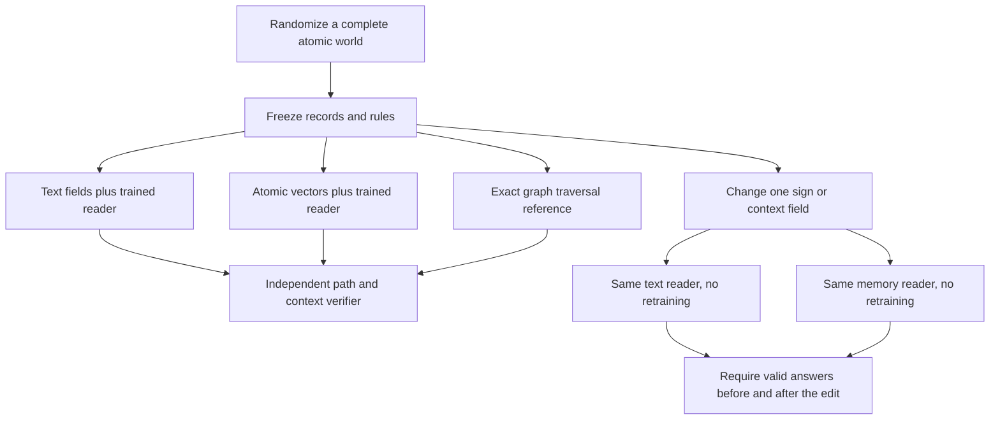

# What the decisive comparison isolates

The answer to a test world is never stored as an input memory. The world consists
of directed signed edges and their context fields. Training worlds and test
worlds have separate global namespaces and newly sampled facts. A reader has to
recover relationships from the supplied world, rather than recall the training
world's composed answer. Local entity aliases and the sign algebra remain fixed.

There are several distinct possible outcomes:

| Observation | What it supports | What it leaves unresolved |
|---|---|---|
| Atomic readout fails | This interface and training budget did not establish reliable access | Whether a reliable interface would improve reasoning |
| Atomic readout succeeds, longer proofs fail | Factual access transferred more readily than longer composition | Whether a different reasoning procedure or training distribution would help |
| Longer proofs improve and edits change valid answers | Evidence-dependent composition in these bounded worlds | Biomedical validity, new vocabularies, large graphs and real discovery |
| Faster fresh prompts, tied after text KV reuse | A prompt-prefill saving in this workload | An advantage over a well-cached text service |
| Better formal task scores than text but worse than exact traversal | A learned-reader gain within the neural comparison | A practical reason to replace deterministic execution for explicit rules |

UNKNOWN requires the correct absence label and citations to the complete fact
bank. That output is less demanding than generating an actual signed path.
UP, DOWN and BOTH therefore have their own public breakdowns. A right label with
a reversed edge, wrong context, incorrect sign, missing opposite-sign witness,
or invalid citation does not count as a supported proof.

Counterfactual edits test replacement of supplied facts without weight updates.
Record-ID permutations test whether citations follow the new binding. Row
permutations test order sensitivity. Memory masking tests dependence on injected
vectors. None of these implements autonomous evidence ingestion or long-term
retention across tasks.

The measured task supplies complete evidence to both readers. It does not test
retrieval recall, document extraction, source independence, calibrated biomedical
confidence, open-web coverage or a clinical evidence product. Biological
associations must not be interpreted using this synthetic sign algebra without
an independently justified mechanism and context.
