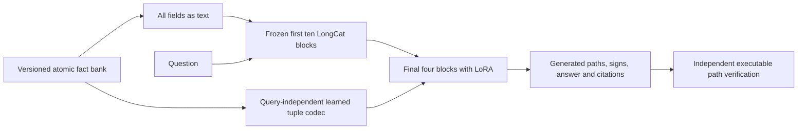

# Memory-use experiment: registered design

This experiment follows the negative scoped-rule comparison. It trains a reader
to reconstruct and use atomic memories, then measures new relationship
compositions. The synthetic signs are stipulated rules, not biological causality.
Previous results and checkpoints remain unchanged.

## Architecture and matched controls

Both conditions use the same pinned native LongCat-Flash-Lite 4-bit weights.
Twelve large native n-gram tables use read-only disk-backed row lookup; native
hashing, quantization, projection and aggregation are unchanged. Sampled native
rows must match exactly before adopting this storage implementation.

The first ten decoder blocks stay frozen. Rank-16 LoRA updates in the final four
blocks train the memory reader. Its atomic codec independently embeds seven
fields: record ID, subject, object, sign, species, variant and source. A learned
projection produces one hidden vector per record, injected at the matching
record slot before the final four blocks. The codec never receives the query,
answer, path, split name or a graph traversal result. It is a new engineered
interface, not an EngramEdit reproduction.

The text condition receives every field as explicit text and trains rank-32
LoRA in the same projections. Expected parameter counts are 5,719,809 for
memory including its codec, versus 5,914,624 for text. Actual counts are recorded.
Text therefore has slightly more capacity. Both conditions receive identical
training examples, target traces, sample order, optimizer update budgets and
gradient accumulation. Neither condition receives held-out composed answers.

## Data and generalization

Each world has its own global entity namespace; local aliases N0 through N15
are normalized identically for text and memory. Facts are randomized afresh in
every world. Record IDs and ordering are randomized independently of answers.
Every answer class contains the same number of records for its stratum.

| Split | Reasoning worlds | Atomic readouts | Designed path depths |
|---|---:|---:|---|
| Training | 384 | 128 | 1–2 |
| Development | 48 | 24 | 1–2 |
| Fresh-world test | 96 | 48 | 1–2 |
| Structural test | 96 | 48 | 3–4 |

UP, DOWN, BOTH and UNKNOWN are balanced among reasoning worlds. Parallel paths,
backward edges, wrong-species/variant traps and disconnected or dead-end edges
prevent a single local cue from determining the answer. BOTH requires paths
with opposite products. UNKNOWN means no qualifying directed path exists in
the complete bounded world.

Sixty-four paired interventions change one sign or context field while keeping
the question and record IDs fixed. The reference answer must change. Readers
are evaluated against the changed bank, without further training. Zeroed-memory
and record-binding/order controls test causal dependence and citation fidelity.

## Training, development and stopping

Two independent final seeds: 1201 and 1202. Maximum initial budget is 512 AdamW
updates per condition, two examples per update, LoRA learning rate 0.00003 with
16-step warmup, no weight decay and global gradient norm clipped to one. The
new atomic codec uses its own learning rate of 0.001; the pretrained reader's
LoRA rate is identical between conditions. The first 64
updates train atomic readout; later updates pair one atomic and one reasoning
example. Both conditions use the same schedule.

Targets contain an explicit JSON path trace, answer and record citations, with
EOS supervision. Atomic targets reconstruct all seven fields. Content tokens
receive higher loss weight than punctuation, identically for both conditions.
Weighted development target NLL every 64 updates nominates one candidate.
Also retain the untrained step-zero and final-budget checkpoints. Generate the
same full development suite for these three candidates (deduplicate identical
checkpoint hashes). Select highest reasoning proof accuracy, then atomic exact
accuracy, then lower development NLL. This prevents target-token loss from
masquerading as successful free-running reasoning. All candidate scores remain
public. The step-zero candidate also prevents a degraded fine-tune from silently
handicapping the text baseline.
The frozen dataset's initial metadata names NLL selection; this pre-test
amendment adds the generated-development comparison. No fact, question, target
or split is changed by that amendment.
Published/evaluated adapter and codec checkpoints are rounded to BF16.

A separate 64-update pilot may diagnose implementation and training failures
using training/development data only. All pilot outcomes and source revisions
are retained. Recipe changes must precede the held-out run.
The first pilot used 0.0003 for all parameters and destabilized the text reader.
Its repetitive development generations were retained and evaluation stopped
early. A second pilot uses the smaller common LoRA rate and separate codec rate
specified above. No held-out outcomes informed this correction.

Before opening test outcomes, evaluate generated development responses. If the
first final seed's text reader has less than 75% valid reasoning proofs, or the
memory reader has less than 90% exact atomic readout, extend both conditions to
1024 updates using their saved optimizer states. The second final seed uses
the resulting common budget. This is a development gate, not an assurance of
success. If it fails at the cap, report that limitation and all test outcomes;
do not claim a successful learned interface from low training loss alone.

## Verification, timing and resources

Answers and executable proofs are separate scores. Every generated path must
start at the requested root, end at the target, respect direction and both
context fields, and have the claimed sign product. BOTH needs both products.
UNKNOWN requires no claimed path and citations to the complete record set.
The grader does not credit a correct label with an invalid trace.

Frozen causal prefix states may be cached for training and development. They
contain only each position's preceding input tokens. Cached/direct logits must
match in parity probes. Feature caches stay local; public manifests record
input, feature, source and model hashes and all regeneration code. Evaluation
uses the full model and the exact published checkpoints, with no test-target
prefix states. Frozen parameter hashes are checked before and after work.

Report training cost, prefix preparation, reader/codec capacity, raw generations,
per-world outcomes, atomic accuracy, proof accuracy and changed-evidence pairs.
Time fixed 32-token completions with and without a reusable facts/instruction
prefix for both conditions. Prefix priming and warm reuse are separate costs.
A speed claim requires comparable supported-answer quality.

Run one large model process at a time. Limit Metal allocation to 27 GB, use small
batches, and record aggregate memory pressure, swap and this process's peaks.
Checkpoint and exit on critical pressure or more than 2 GiB new swap use.
Other sessions and services are never stopped or changed. Aggregate telemetry
is publishable; other applications' names and task contents are not recorded
in public artifacts.

The result concerns a bounded learned memory interface for formal relationships.
It does not establish rare-disease discovery, calibrated clinical confidence,
automatic evidence intake or million-edit scalability.

## Pre-test clarifications

The [depth-only control](DECISIVE-DEPTH-CONTROL.md) isolates longer paths from
the larger bank and two new record IDs in the original structural stratum.
The [candidate-retention clarification](DECISIVE-SELECTION-AMENDMENT.md) keeps
every previously generated development candidate eligible after extending
training. Both clarifications were public before opening held-out outcomes.
Neither changes training facts, training targets or the common update cap.

The [trained-only diagnostic](DECISIVE-TRAINED-DIAGNOSTIC.md) separately tests
the strongest scored memory candidate with a positive training step, so an
initial selection fallback cannot be misrepresented as successful training.

Here, an unopened held-out outcome means a neural reader's prediction or error
on a held-out case. Gold labels, graph-solver checks and tokenizer/input audits
are part of benchmark construction and were available before fitting. No
held-out neural prediction informed the recipe, candidate rules or test controls.
