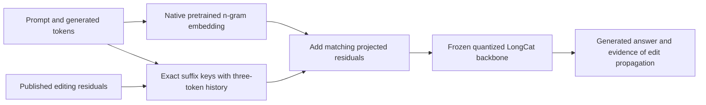

# Native LongCat conditional-memory experiment

The original Qwen experiment attaches an untrained memory interface to a frozen
backbone. EngramEdit instead edits native pretrained conditional memory. This
second experiment uses the same **LongCat-Flash-Lite** model family as the paper,
through MLX-LM's existing `longcat_flash_ngram` implementation.

## Hardware and precision

The selected MLX checkpoint is `mlx-community/LongCat-Flash-Lite-4bit`, revision
`0435b3bca4418830335d784317fe7f67f8383253`. Its eight weight shards total
38,575,121,528 bytes (38.6 GB decimal). Inference additionally needs activations,
KV caches, editing residuals, and operating-system headroom. The runner limits
MLX allocations to 48 GB decimal and its allocator cache to 256 MiB; this is an
allocation bound, not a reservation or guarantee about total system memory.

The paper uses the 68.5B model in BF16 on two NVIDIA RTX PRO 6000 GPUs. The 4-bit
Mac run is a **quantized adaptation**, not an exact numerical reproduction.
Inactive experts and native memory tables still need storage even though only a
small subset of parameters is activated per token. The larger 6-bit conversion
leaves too little headroom for this initial 64 GB Mac experiment.

Measured runs and their limitations are in [LongCat results](LONGCAT-RESULTS.md).

## First gate: replay released edits

The authors publish a separate `engramedit_state.pt` containing cumulative
exact-key additive residuals. We replay their MQuAKE-3K state at revision
`6222d320052e349af9cf76417ebd329da8b5350b`. The preparation script safe-loads it
using `torch.load(..., weights_only=True)`, validates keys and finite dimensions,
and exports float32 safetensors plus a checksum manifest. Float32 conversion
preserves the stored lower-precision values; inference casts updates back to the
native embedding output dtype, as the upstream wrapper does.

At each token position, the MLX wrapper checks exact suffixes of lengths 2, 3,
and 4. Matching updates are added **after** the native embedding average. The
pretrained hashed tables, projection matrices, and backbone remain unchanged.
The wrapper snapshots the previous three tokens before the native cache advances,
so edits can activate during incremental generation and across prefill chunks.
No new row is learned in this replay step.



## Reproduce

```bash
uv sync --extra dev --extra longcat
uv run --extra longcat python scripts/prepare_longcat.py --download-model
uv run python scripts/run_longcat.py --cases 6 \
  --output runs/longcat-mquake-smoke

# All three question variants for each of 30 cases.
uv run python scripts/run_longcat.py --cases 30 --questions-per-case 3 \
  --output runs/longcat-mquake-30
```

For this replay, PyTorch converts the upstream checkpoint in a separate process.
The LongCat inference process uses MLX. The newer comparison also uses a small
PyTorch BGE encoder on CPU for actual retrieval. Model loading uses the built-in MLX architecture;
it does not execute the model repository's remote Python files.
The serialized fast tokenizer is loaded directly: generic `AutoTokenizer` would
otherwise try to resolve LongCat's custom PyTorch configuration, which is not
needed for the built-in MLX model or the serialized tokenizer.

Optional independent replay checks:

```bash
git clone https://github.com/ModalityDance/EngramEdit.git models/EngramEdit-reference
git -C models/EngramEdit-reference checkout fb4089be4eec2575847d7e71342ff545ccb70508
uv run --extra longcat python scripts/check_longcat_reference.py \
  --upstream-root models/EngramEdit-reference
uv run python scripts/check_longcat_tokenizer.py
```

Each exported run includes the three source files used in its inference path.
Concatenating `run_longcat.py`, `longcat.py`, and `longcat_keys.py` in that order
and hashing their bytes reproduces `config.json`'s `source_sha256`.

The first six cases after the upstream seed-0 shuffle are fixed before generation.
By default we use the first question per case, both standard and chain-of-thought
demonstrations, greedy decoding, and upstream limits of 32 / 128 generated tokens.
All raw generations, exact-match answers, prompt hashes, token counts and timing
are retained. The runner checks that the released checkpoint covers every atomic
edit in every selected case. It also verifies disabled-wrapper equality on the
real model and checks cached generation on an actually edited key.

Conditions:

- **Base:** native pretrained LongCat without the published editing residuals.
- **Released memory:** the same model with published MQuAKE editing residuals.
- **Text edits:** residuals disabled, with that case's revised facts in the prompt.

All are scored against both original and stipulated updated answers. MQuAKE uses
counterfactual facts: success means consistency with a requested fictional edit,
not medical correctness or current-world truth. The text condition supplies edited
facts, not every premise needed in a multi-hop answer, and is not actual retrieval.
Condition order and tiny sample size make timing exploratory.

## Scope of this replay and the subsequent comparison

This replay implements **released-checkpoint inference**. The subsequent
[controlled comparison](COMPARISON.md) implements fresh target optimization and
joint allocation in `engram_poc/longcat_editor.py`, starting from the native base.
It uses fixed atomic expressions and local frequency calibration, rather than
claiming the paper's generated expression/context and Wikipedia setup.
Published MQuAKE edits are not a biomedical knowledge cartridge.

The comparison measures bounded locality, matched KG/RAG controls and update
costs. Its small case count and selected-neighbor task still cannot establish
clinical utility or quality at biomedical scale. The earlier Qwen results are
retained unchanged and are not pooled with either LongCat task.

References: [EngramEdit paper](https://arxiv.org/abs/2610.10533),
[authors' code](https://github.com/ModalityDance/EngramEdit),
[LongCat model](https://huggingface.co/meituan-longcat/LongCat-Flash-Lite),
[MLX conversion](https://huggingface.co/mlx-community/LongCat-Flash-Lite-4bit).
