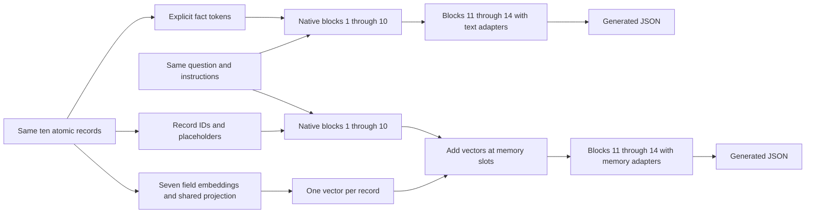
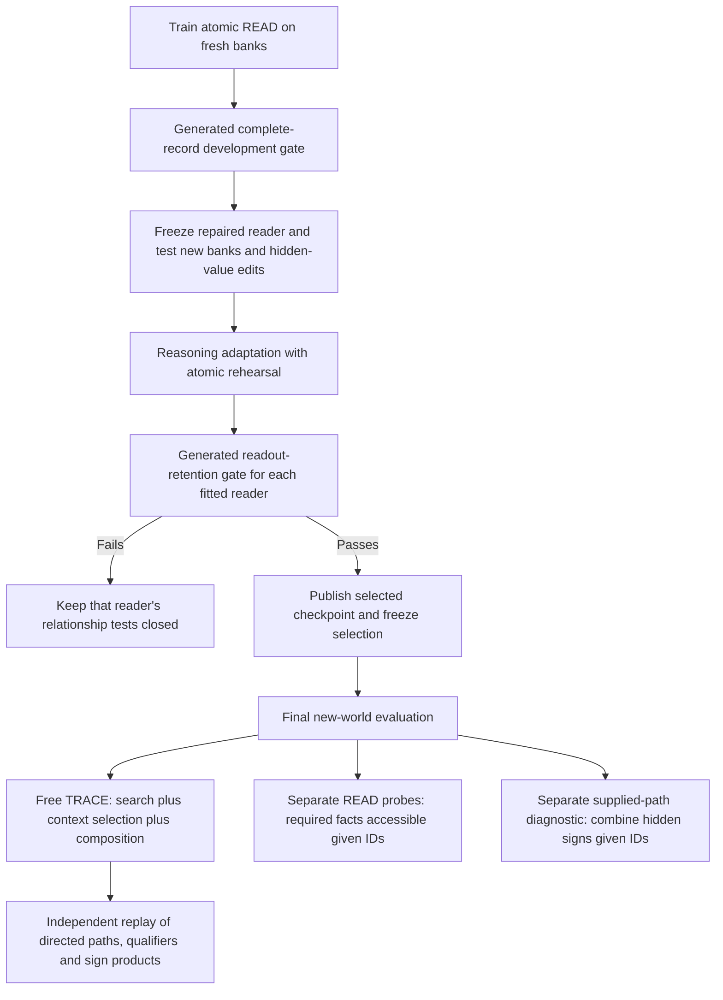

# What this memory interface tests

Both conditions use the same pinned LongCat backbone. Text supplies every fact
as ordinary tokens. Memory supplies the record ID and a placeholder in the
prompt, then adds one learned vector at each record's slot after decoder block
ten. The codec sees only the seven atomic record fields; it receives no query,
path, graph traversal or answer. Native backbone weights remain frozen.

The two branches are separate evaluations of the same pinned backbone with
different adapters. Both use the original LM head. Text receives no codec
addition; memory receives no text version of the hidden fact values. See the
[implementation](../engram_poc/decisive_model.py) and
[prompt construction](../engram_poc/decisive_prompts.py).

Text facts have fourteen decoder blocks of processing. Memory values have four
after injection; the question's earlier states were computed without those
values. This is a substantive difference in representation and processing depth.
A negative result applies to this late-slot implementation, not every Engram
architecture. The shared codec is a learned record encoder, not a graph solver
or an EngramEdit replication.

The repaired READ interface reconstructs a record given its ID. That success
establishes access by an explicit address. A TRACE question instead names root
and target nodes plus species and variant. It requires finding the relevant
records, respecting direction and qualifiers, and combining their signs. Exact
READ performance does not establish all those capabilities.

The READ probes never supply their oracle-selected IDs to the main TRACE call.
The supplied-path diagnostic is explicitly separate: it provides record IDs,
withholds signs and answers, enumerates every sign assignment, and flips an
irrelevant edge independently. It scores the next sign token and complete
truth-table success, not free path finding. These checks help separate access,
search and value composition without treating fluent output as a valid proof.

During composition, the frozen-encoder control updates 2,957,312 reader
parameters. The joint condition updates its codec and reader, 5,719,809 in total.
Text updates a larger reader with 5,914,624 parameters. Both memory conditions
start from additional readout-alignment training. Reasoning examples, sampled
schedules and maximum update budgets match across modes for each seed.
Selection requires actual generated readout; teacher-forced loss is insufficient.

The world is a complete synthetic graph with sixteen anonymous node aliases and
ten record IDs. Signs are stipulated algebra. Reading a source label does not
validate that source. Mapping external biomedical IDs onto these aliases does
not add their biological semantics or establish causal inference. The graph
execution oracle defines gold for this task; it is not independent ARAX or
clinical validation.

See the [readout repair](READOUT-REPAIR-RESULTS.md),
[composition registration](COMPOSITION-PROTOCOL.md),
[joint-training amendment](COMPOSITION-JOINT-AMENDMENT.md), and
[retention-failure handling](COMPOSITION-RETENTION-AMENDMENT.md).
