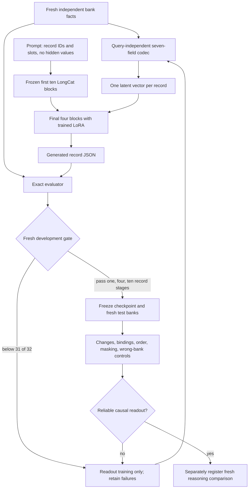

# Establishing memory readout before judging reasoning

This follow-up addresses a failed prerequisite in the earlier decisive study.
It does not reuse the earlier reasoning test as a development set or claim a new
reasoning result. A functioning readout interface must be frozen first.

## Implementation audit

Audit the final seed-1202 reader on four old training and four old development
banks, with both its FP32 optimization weights and its BF16 published weights.
Check every loaded trainable array against the checkpoint, causal cached-prefix
versus direct teacher-forced logits, and incremental-prefix versus uncached
logits. Retain per-token losses, argmax predictions and generated field errors.
These are diagnostic cases, not new held-out evidence.

## Readout-only training

Retain LongCat-Flash-Lite, its frozen native backbone, the original one-vector
seven-field codec and rank-16 LoRA on the final four blocks. No graph traversal,
reasoning target, answer label, path, or query enters the codec. Simplify the
prompt to record reconstruction. Every update uses two independently generated
banks with independent record values; banks are not a small recycled corpus.
Train complete seven-field JSON, with greater loss weight on the six hidden
values than on JSON syntax or the visible requested record ID.

Train a curriculum of one, four, then ten records. Record IDs are sampled from
F0 through F9 and row order is randomized. Advancement requires at least 31/32
exact generated development records in the current stage, using the published
BF16 precision. This development gate is a training diagnostic, not the final
reliability claim. Save every evaluated checkpoint and select on exact generated
readout, not just teacher-forced loss. Start from a fresh initialization, seed
2301, codec learning rate 0.001 and reader learning rate 0.00005, with 16-update
warmup and gradient norm clipping at 1. The initial budget is 2048 updates;
failed attempts and any subsequent revisions remain in the public record.

### Development-only amendment: isolated fields

The first fresh-bank run reached 28/32 full records, then plateaued: hidden
object IDs remained wrong on held-out pairs even as training loss approached
zero. The next run tests field-isolated supervision. Initialize from that run's
best generated-readout checkpoint, promote its BF16 adapter and codec arrays to
FP32 for optimization, and use seed 2302. For 256 updates, ask for one hidden
field at a time, balanced across the six fields. Thereafter alternate isolated
field draws with full-record draws. A field target contains the visible record
ID and only the requested field; its autoregressive prefix cannot expose any
other hidden field value. The codec and its one-vector-per-record interface are
unchanged. Complete-record generated validation still controls advancement.
The initial field-curriculum budget is 3072 updates. This tests a suspected
teacher-forcing shortcut; it does not assert that shortcut as the sole cause.
An interrupted BF16-optimization pilot is retained separately from the corrected
FP32 run. No fresh test outputs have been used to make this amendment.

### Development-only amendment: noisy past-value prefixes

The isolated-field audit of the corrected continuation found 28/32 object
readouts when object was requested alone, versus 19/32 in full records from
the same checkpoint and banks. Full-record exactness was 18/32. This supports
interference from preceding generated values, alongside remaining alignment
errors; it does not prove a sole causal mechanism.

Continue from that exact step-512 checkpoint with seed 2303, FP32 optimization,
equal isolated-field/full-record draws, no additional field-only warmup, and a
4096-update initial budget. For full-record training only, independently replace
each past hidden-field value with a different valid value with probability 0.5,
requiring the same token count. The true bank and correct next-token labels
remain intact. Frozen prefix computation sees only causal past tokens, including
these corruptions. Evaluation uses normal, uncorrupted generation.

All **bank facts** and full correct output targets retain the pair exclusion.
Corrupted teacher-forcing contexts can contain other string combinations; the
claim is not that held-out alias pairs are absent from every noisy decoder
context. The purpose is to teach the decoder to recover the next field from
memory when earlier output values are wrong. Keep all prior failed runs and
the isolated-field diagnostic. The final causal test remains unopened.

All training records use subject/object pairs satisfying
`(5 * subject + 3 * object) % 8` in 2 through 7. Development banks use remainder
0, and fresh test banks use remainder 1. Thus every subject and every object
value occurs during training, while development and test relationships are
excluded from every training bank. Signs, species, variants, and source are
sampled independently. This is a closed-vocabulary compositional readout test,
not a test of previously unseen biomedical entity names.

Development bank seeds are `41000000 + 10000 * record_count + index`, with
indices 0 through 31. Test seeds will be fixed and the selected checkpoint
hashed before opening test outputs. No reasoning test is run as part of this
repair phase.

## Causal reliability gate

After freezing a successful reader, evaluate at least 256 fresh ten-record
test banks, complete seven-field exact match and per-field accuracy. Require
at least 95% exact match before calling the interface usable. Report a binomial
confidence interval; do not describe a small perfect development sample as
guaranteed reliability.

Use additional paired tests with the same visible prompts and requested IDs:
change hidden fields, permute the binding of record values to IDs, and change
row order. Masking the codec or substituting an unrelated bank should destroy
value accuracy. Report those ablations separately from genuine readout errors.
Hidden fields must not appear in prompts, be converted to text by a helper, or
be deterministically decoded by the evaluator as model output. Save the raw
generations and bank contents so these claims can be independently checked.

The final readout interface must then be frozen before a separately registered,
fresh reasoning comparison. Any redesign that expands slots, aligns to text,
or adds an auxiliary neural decoder must be identified explicitly, with its
compression and compute costs, rather than silently treated as the original
one-vector interface.

## Mac resource policy

Serialize model processes. Keep the existing 27 GB Metal allocation limit and
64 MiB cache cap, inspect aggregate memory pressure and swap, and exit with an
own-run checkpoint if pressure becomes warning/critical or swap grows by more
than 2 GiB. Preserve other sessions. The full frozen prefix can be computed
online within the limit because native n-gram tables remain disk-backed.

During one development handoff, an inference cleanup context swallowed an
interrupt and a second model load briefly overlapped it. Swap rose from about
4.58 to 13.72 GiB; both own jobs were stopped, and no other session was modified.
This is retained as a resource incident, not a successful bounded run. Subsequent
jobs take an exclusive kernel file lock before loading, stop on warning pressure
as well as critical pressure, and defer cancellation until outside the inference
context. Cleanup telemetry cannot suppress a checkpoint receipt by rethrowing
the resource-guard failure. A process-lock regression test verifies rejection of
overlap and release after the owner closes.
