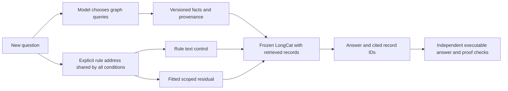

# Richer relationships: frozen protocol

This extends the first comparison without replacing its results. It asks two
separate questions: whether explicit relation/context addresses reduce factual
interference, and whether a latent library of generic rules helps a frozen model
reason over new evidence. No advantage is assumed.

The model remains the pinned 4-bit MLX LongCat-Flash-Lite checkpoint. Scoped
memory is an engineered interface, not native n-gram addressing or an exact
EngramEdit replication. An exact `(entity, relation, context)` dictionary selects
a learned residual; it does not compute an answer or traverse the graph.
The caller supplies the rule address explicitly, so learned semantic routing is
not evaluated.

## What is fitted

- 24 atomic records: three repeated entities, two relations, two species and two
  variant contexts. Values are randomly assigned opaque gene/pathway labels.
- Six generic rule definitions, paired under three repeated motif names with
  different scope identifiers. Rule text contains no held-out entity IDs or
  composed answers.
- The same independent target fits supply both the old jointly allocated
  n-gram memory and the new independent scoped rows. The backbone stays frozen.
- At most 25 Adam steps, learning rate 0.5, existing KL/norm penalties, three
  atomic expression templates and two prefix contexts. No composed-answer
  supervision and no test-result hyperparameter selection.

Scoped storage changes both address granularity and allocation. Its row count
differs from the old n-gram table, and direct delta storage avoids that table's
joint regularization. A difference cannot be attributed solely to addressing or
claimed to be a parameter-matched architecture improvement.

## Held-out reasoning

48 synthetic cases, eight each for:

| Family | Required operation |
|---|---|
| Branching join | Match gene and phenotype branches to the same pathway |
| Context | Select matching species and variant annotations |
| Signed paths | Compose directed signs only within the stipulated context |
| Provenance | Deduplicate primary-provider IDs across aggregator copies |
| Conflict | Preserve explicit support and refutation without majority voting |
| Abduction | Identify which unproven candidate edge would complete a join |

These are explicit formal rules, not biological causal laws. `UNKNOWN` means
unprovable from the bounded evidence; it is not equivalent to refutation.
Distinct primary-provider IDs do not establish independent experiments.

Six additional development worlds test the interface and are excluded from test
denominators. Only development outputs may inform interface corrections, which
must precede the held-out run and be recorded. The initial gold-evidence probe
uses the native model before any fitting.

The first development tool probe queried motif/source names and sometimes spent
its final response on another lookup. Before the held-out run, the interface
was clarified: rules are already supplied, provider IDs are metadata, the rule
cue follows tool history, and each response receives its remaining budget.
Raw continuation prompts still produced empty completions and spurious lookups.
A third development probe applies the pinned model's native chat template with
thinking disabled to all reasoning conditions. Literal memory recall remains a
raw continuation diagnostic matching the fitting format. All development runs
are retained separately; no held-out result informed these interface changes.

Twelve ARAX cases audit retained direction, species, aspect and provider
annotations across Fabry, Gaucher and Rett snapshots. Original subject/object
orientation is retained. Opposite incoming effects from different compounds are
an inventory of recorded directions, not a contradiction about one claim.
Claim-level conflict/provenance cases also match the subject and predicate.
No causal path algebra is applied to actual ARAX annotations. Tissue coverage is
too sparse to claim tissue-specific validation. Public records are blinded,
bounded metadata projections with snapshot/edge hashes; raw composite graphs
remain local.

## Conditions and budgets

- Gold local evidence plus text rules: reasoning ceiling conditional on correct
  evidence selection, not end-to-end retrieval.
- The same evidence plus scoped, n-gram, shuffled or disabled latent rules.
- SQLite FTS5 BM25 top-12 and BGE-small-en-v1.5 hybrid top-12 retrieval over the
  global corpus, with text rules. BGE query encoding is performed online on CPU.
- Graph agents with text, scoped or disabled rules. Each model chooses its own
  lookup entities, predicates, context filters and edge directions. No gold
  starting entity or hop count is passed separately to the controller.
- Four model rounds, at most two lookups per round and six in total, at most 16
  records per lookup. The graph executes only model-supplied parameters.
- Greedy generation; stop at the first complete JSON action/answer, at most 192
  generated tokens per model call. No external judge or paid model is used.

Rule addressing is shared and explicit. Graph query planning is not an exact
reproduction of Graph-CoT; it is a bounded local agent baseline inspired by its
reason/inspect/execute loop. One-shot retrieval is not the best achievable RAG.

## Scoring and interventions

Report answer-label accuracy separately from answer-plus-proof accuracy.
A proof must cite retrieved record IDs sufficient under the declared rule.
Unknown/none answers require an inspected complete local core or audited complete
lookup certificates covering the required entity/context or reachable frontier,
with citations to relevant returned records. An arbitrary empty subset cannot
certify absence; an exhaustive matching empty lookup can. Extra context filters
cannot certify absence in a broader query. Raw generations, actions and tool errors
are retained. This checks formal support, not the fidelity of every unspoken
reasoning step or clinical correctness.

Six counterfactual evidence interventions change one world at a time. Rules and
memory vectors remain fixed, so this tests responsiveness to new supplied
evidence, not autonomous learning. Counterfactual cases are paired exploratory
probes, not extra independent test cases.

Fixed 32-token timing uses 12 synthetic queries, two repeats and three memory
conditions, randomized within query. Model/OS caches are warm; no prompt-prefix
cache is reused. Output length is matched; answer quality is not. Agent wall
time, calls, tool use and observed seconds per valid proof are reported separately.

Sources and checkpoints are hashed; full frozen parameters are fingerprinted
before and after fitting/inference. Previous artifacts remain unchanged.

References: [EngramEdit](https://arxiv.org/abs/2610.10533),
[ProofWriter](https://arxiv.org/abs/2012.13048),
[Graph-CoT](https://arxiv.org/abs/2404.07103).
No ProofWriter or GRBench scores are claimed for these custom cases.
